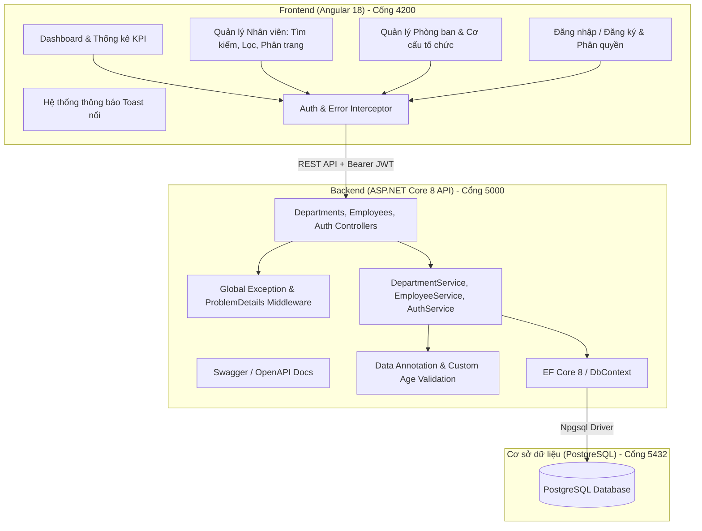

# Employee Management System (Quản lý Nhân Viên & Phòng Ban)

Hệ thống quản lý thông tin nhân sự và cơ cấu phòng ban đa tầng hoàn chỉnh, xây dựng theo kiến trúc hiện đại:
- **Frontend**: Angular 18 (Standalone Components, Reactive Forms, Debounce Search, Dynamic Filtering, Server-side Pagination, Toast Alerts, Modal Dialogs).
- **Backend**: ASP.NET Core 8 Web API (Clean Architecture, EF Core 8, ProblemDetails Global Exception Handler, Fluent Validation, JWT Authentication & Role-based Authorization, Swagger UI).
- **Database**: PostgreSQL 16/18 với Entity Framework Core Migrations & Seed Data tự động.
- **Testing**: xUnit, FluentAssertions, EF Core InMemory Test Suite.
- **DevOps**: Docker & Docker Compose sẵn sàng triển khai một lệnh.

---

## 🏗️ Kiến Trúc Hệ Thống



---

## ✨ Tính Năng Nổi Bật

### 1. Quản lý Nhân Viên (Employees)
- **CRUD đầy đủ**: Thêm mới, xem chi tiết hồ sơ, cập nhật thông tin và xóa nhân viên.
- **Tìm kiếm thông minh (Debounce Search)**: Tìm kiếm tức thì theo họ tên, email, số điện thoại, chức vụ với cơ chế debounce 350ms giảm tải truy vấn server.
- **Bộ lọc đa tiêu chí**:
  - Lọc theo **Phòng ban** (IT, HR, Kế toán, Marketing, R&D...).
  - Lọc theo **Trạng thái làm việc** (`Đang làm việc - Active`, `Nghỉ phép - OnLeave`, `Đã thôi việc - Terminated`).
  - Lọc theo **Khoảng lương tối thiểu/tối đa**.
- **Sắp xếp linh hoạt (Sorting)**: Bấm vào tiêu đề cột bảng để sắp xếp tăng/giảm theo Họ tên, Email, Phòng ban, Chức vụ, Lương, Ngày vào làm, Trạng thái.
- **Phân trang từ máy chủ (Server-side Pagination)**: Hỗ trợ tùy chọn 5, 10, 20, 50 bản ghi/trang, điều hướng trang nhanh.
- **Xuất báo cáo Excel chuyên nghiệp (.xlsx)**: Xuất toàn bộ hoặc theo bộ lọc tìm kiếm/phòng ban/lương, tự động định dạng tiêu đề, màu sắc thương hiệu, định dạng tiền tệ VNĐ và hàng tính tổng quỹ lương.
- **Validation chặt chẽ**:
  - Kiểm tra họ tên, định dạng email hợp lệ, kiểm tra email trùng lặp.
  - Số điện thoại chuẩn định dạng Việt Nam (`09...`, `03...`, `+84...`).
  - Kiểm tra ngày sinh đủ từ 18 tuổi trở lên (sử dụng custom validator).
  - Mức lương tối thiểu từ 1.000.000 VNĐ.

### 2. Quản lý Phòng Ban (Departments)
- **CRUD phòng ban**: Quản lý tên phòng ban, mã phòng ban (duy nhất), địa điểm văn phòng, mô tả chức năng nhiệm vụ.
- **Thống kê nhân sự**: Hiển thị số lượng nhân sự thuộc từng phòng ban theo thời gian thực.
- **Bảo toàn dữ liệu (Data Integrity)**: Ngăn chặn xóa phòng ban nếu phòng ban đó vẫn đang còn nhân viên công tác kèm thông báo hướng dẫn điều chuyển.

### 3. Quản lý Chấm Công & Điểm Danh (Attendance & Time Tracking)
- **Chấm công 1 chạm (Quick Check-In / Check-Out)**:
  - Tích hợp **đồng hồ thời gian thực (Live Digital Clock)** hiển thị chính xác theo từng giây và ngày tháng hiện tại.
  - Nút **Chấm công vào (Check-In)** và **Chấm công ra (Check-Out)** tự động phát hiện trạng thái ca làm việc trong ngày.
  - Tự động nhận diện đi muộn (sau 08:30) hoặc về sớm (trước 17:00), tự động tính lũy kế số giờ làm việc thực tế.
  - Hỗ trợ thêm ghi chú chấm công (lý do đi muộn, làm việc từ xa WFH, đi gặp đối tác...).
- **Báo cáo & Thống kê chuyên cần (KPI Summary)**:
  - Thống kê tổng lượt chấm công trong tháng.
  - Tỷ lệ chuyên cần (On-time Rate %).
  - Tổng số lượt đi muộn & về sớm để cảnh báo vi phạm kỷ luật lao động.
  - Tổng số giờ công tích lũy và số giờ trung bình/lượt.
- **Xuất bảng chấm công ra Excel (.xlsx)**: Xuất chi tiết giờ vào, giờ ra, số giờ công, trạng thái và ghi chú theo từng khoảng thời gian hoặc phòng ban, kèm hàng tổng số giờ công.
- **Bộ lọc & Tra cứu đa năng**:
  - Tìm kiếm theo họ tên nhân viên, chức danh, email, phòng ban.
  - Lọc theo phòng ban và trạng thái (Đúng giờ, Đi muộn, Về sớm, Đi muộn & Về sớm, Vắng mặt, Nghỉ phép).
  - Chọn nhanh khoảng thời gian: Hôm nay, 7 ngày qua, Tháng này hoặc tùy chỉnh ngày.
- **Chấm công bổ sung & Điều chỉnh công (Dành cho Quản trị & Quản lý)**:
  - Quản lý có thể tạo phiếu chấm công bù cho nhân viên quên quẹt thẻ.
  - Cho phép điều chỉnh giờ vào, giờ ra, số giờ công và giải trình lý do.
  - Toàn bộ 24 Unit Tests tự động bao phủ logic chấm công, tính giờ và bảo toàn dữ liệu.

### 4. Bảo Mật & Phân Quyền (JWT & RBAC)
Hệ thống tích hợp JWT Bearer Token với 3 cấp quyền hạn:
- **Admin**: Toàn quyền xóa nhân viên, xóa phòng ban, thêm/sửa tất cả dữ liệu.
- **Manager**: Quyền tạo mới và cập nhật thông tin nhân viên, phòng ban.
- **Employee / Khách xem**: Quyền xem danh sách, tra cứu hồ sơ, lọc và tìm kiếm.

#### Tài khoản mẫu mặc định (Đã nạp sẵn trong Seed Data):
| Tài khoản | Mật khẩu | Quyền hạn |
| :--- | :--- | :--- |
| `admin` | `Admin@123` | **Admin** (Toàn quyền) |
| `manager` | `Manager@123` | **Manager** (Thêm/Sửa) |
| `employee` | `Employee@123` | **Employee** (Chỉ xem) |

> 💡 *Trang Đăng nhập có sẵn 3 nút "1-click điền nhanh" tài khoản mẫu để bạn kiểm thử ngay lập tức!*

---

## 🚀 Hướng Dẫn Chạy Ứng Dụng

### Cách 1: Khởi chạy bằng Docker Compose (Khuyên dùng - 1 câu lệnh)
Yêu cầu: Đã cài Docker & Docker Desktop.
```bash
docker compose up --build
```
Sau khi các container khởi động:
- **Frontend Angular UI**: [http://localhost:4200](http://localhost:4200)
- **Backend API & Swagger**: [http://localhost:5000/swagger](http://localhost:5000/swagger)
- **PostgreSQL**: Cổng `5432`

---

### Cách 2: Khởi chạy thủ công cho Môi Trường Phát Triển (Local Dev)

#### 1. Khởi động PostgreSQL
Đảm bảo PostgreSQL đang chạy trên cổng `5432` với tài khoản `postgres` / `postgres`. Tạo cơ sở dữ liệu:
```sql
CREATE DATABASE employee_management_db;
```

#### 2. Khởi chạy ASP.NET Core Web API
```bash
cd backend
dotnet ef database update --project src/EmployeeManagement.Infrastructure --startup-project src/EmployeeManagement.API
dotnet run --project src/EmployeeManagement.API
```
API sẽ lắng nghe tại `http://localhost:5000`. Truy cập Swagger: [http://localhost:5000/swagger](http://localhost:5000/swagger).

#### 3. Khởi chạy Angular Frontend
```bash
cd frontend
npm install
npm start
```
Truy cập giao diện tại [http://localhost:4200](http://localhost:4200).

---

## 🧪 Kiểm Thử Tự Động (Unit Tests)

Bộ kiểm thử unit test toàn diện cho các tầng logic nghiệp vụ, bảo mật, mã hóa mật khẩu, kiểm tra trùng lặp và phân trang:
```bash
# Chạy toàn bộ 27 Unit Tests backend
dotnet test backend/EmployeeManagement.sln

# Kiểm tra build production của Frontend
cd frontend && npm run build
```

---

## 📂 Cấu Trúc Thư Mục Dự Án

```
Employee Management/
├── backend/
│   ├── src/
│   │   ├── EmployeeManagement.Core/           # Entities, DTOs, Enums, Interfaces, Custom Validators
│   │   ├── EmployeeManagement.Infrastructure/ # EF Core AppDbContext, Migrations, SeedData, Services
│   │   └── EmployeeManagement.API/            # Controllers, JWT Config, Global Exception Middleware
│   ├── tests/
│   │   └── EmployeeManagement.Tests/          # Unit tests xUnit & FluentAssertions
│   ├── Dockerfile
│   └── EmployeeManagement.sln
├── frontend/
│   ├── src/
│   │   ├── app/
│   │   │   ├── core/                          # Services (Auth, Employee, Department, Toast), Interceptors, Guards
│   │   │   ├── shared/                        # Components: Navbar, Pagination, ConfirmModal, Toast
│   │   │   └── features/                      # Dashboard, Employees List/Modal, Departments List/Modal, Auth
│   │   └── styles.css                         # Design system CSS chuẩn hiện đại
│   ├── Dockerfile
│   └── nginx.conf
├── docker-compose.yml
├── .gitignore
└── README.md
```
